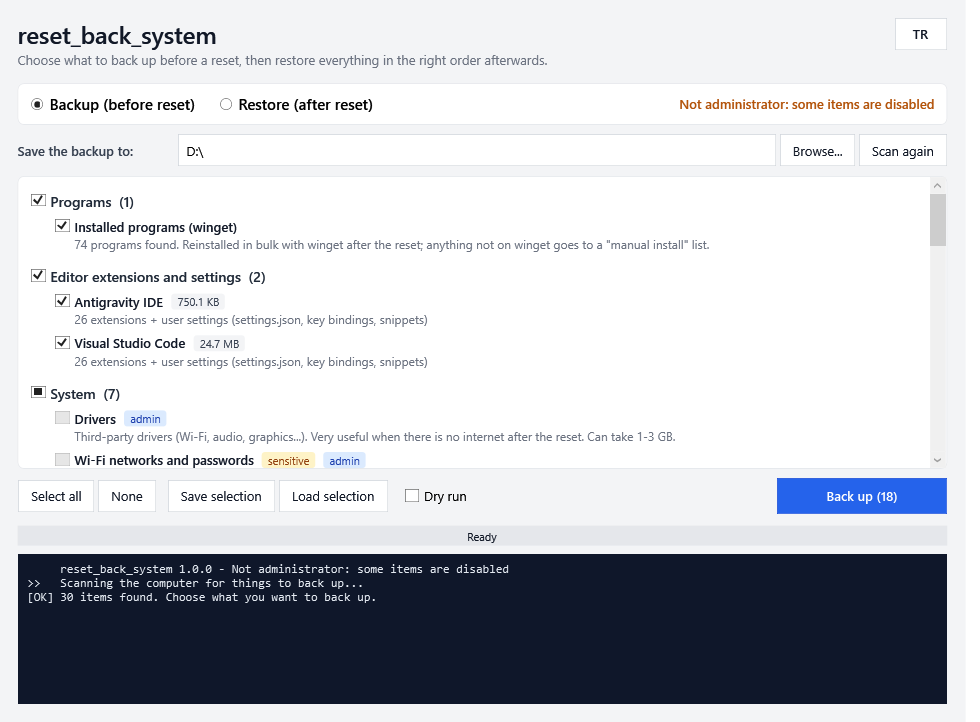

# reset_back_system

> 🇹🇷 [Türkçe](#-türkçe) · 🇬🇧 [English](#-english)

Windows'u formatlamadan önce **neyin yedekleneceğini onay kutularıyla seç**, format sonrası **hepsini doğru sırayla geri yükle**.
Kurulum gerektirmez: Windows'ta hazır gelen PowerShell 5.1 ve WPF ile çalışır.

<p align="center"></p>

---

## 🇹🇷 Türkçe

### Hızlı başlangıç
1. [Releases](https://github.com/OmerYurekli05/reset_back_system/releases) sayfasından son `reset_back_system-x.y.z.zip` dosyasını indir ve bir klasöre çıkar
   (ya da `git clone https://github.com/OmerYurekli05/reset_back_system.git`).
2. **`ResetBack.exe`** (ya da `ResetBack.cmd`) dosyasına çift tıkla. Program yönetici izni ister (sürücü, Wi-Fi, güç planı için gerekli).
3. **Format öncesi:** "Yedekle"yi seç, hedef olarak **harici disk ya da D: gibi format atılmayacak bir disk** göster, istediklerini işaretle, *Yedekle*'ye bas.
4. **Format sonrası:** programı tekrar aç, "Geri Yükle"yi seç. Yedek otomatik bulunur (ya da `ResetBack-tarih` klasörünü göster), *Geri yükle*'ye bas.

> İpucu: Önce **Deneme modu** ile çalıştır. Hiçbir şeye dokunmadan neyin yapılacağını gösterir.

### Neler yedeklenir?
| Kategori | İçerik | Geri yükleme |
|---|---|---|
| **Programlar** | Kurulu programların tam listesi + `winget export` | `winget import` ile en güncel sürümler kurulur. winget'te olmayanlar **"elle kur" listesi** olarak raporlanır |
| **Editörler** | VS Code, Insiders, Cursor, Windsurf, Antigravity, VSCodium: eklenti listesi + `User` ayarları | Ayarlar kopyalanır, eklentiler tek tek kurulur |
| **Sürücüler** | `pnputil /export-driver` ile üçüncü parti sürücüler | `pnputil /add-driver`. Format sonrası internet yoksa hayat kurtarır |
| **Wi-Fi** | Kayıtlı ağlar, şifreleriyle *(hassas)* | `netsh wlan add profile` |
| **Güç planı** | Etkin plan | İçe aktarılır ve etkinleştirilir |
| **BitLocker** | Kurtarma anahtarları *(hassas)* | Sadece saklanır, geri yüklenmez |
| **hosts / ortam değişkenleri** | hosts dosyası, kullanıcı değişkenleri | Path **birleştirilir**, üzerine yazılmaz |
| **Registry** | HKCU / HKLM\SOFTWARE başvuru kopyası | Sadece saklanır (otomatik yüklemek sistemi bozabilir) |
| **Kişisel klasörler** | Masaüstü, Belgeler, Resimler, İndirilenler, Videolar, Müzik | Yeni kullanıcı klasörlerine kopyalanır. OneDrive klasörleri işaretlenir |
| **Uygulama ayarları** | `.ssh`, `.gitconfig`, Claude Code, Windows Terminal, Notepad++, OBS, Minecraft, ETS2/ATS, G HUB, MSI Afterburner, tarayıcı yer imleri, Firefox, VLC, qBittorrent, ShareX, Rainmeter, FileZilla, Steam… ([katalog](catalog/apps.json)) | Kendi yerlerine geri kopyalanır |

Sadece **bilgisayarda gerçekten bulunanlar** listelenir. Yollar `%APPDATA%`, `%DOCUMENTS%` gibi değişkenlerle saklanır, bu yüzden yeni sistemde kullanıcı adı farklı olsa bile doğru yere gider.

### Güvenlik
- **Hassas** öğeler (Wi-Fi şifreleri, SSH/VPN anahtarları, BitLocker) varsayılan olarak **seçili gelmez** ve yedeklemeden önce uyarı verilir.
- Yedek, format atılacak **C: diskine** kaydedilmek istenirse uyarı verilir.
- Geri yüklemeden önce ilgili program **açıksa** kapatman istenir.
- Geri yükleme sırası: sürücüler → Wi-Fi → programlar → eklentiler → sistem ayarları → kişisel klasörler → uygulama ayarları.
- Her işlem log dosyasına yazılır (yedek klasöründe ve `%LOCALAPPDATA%\reset_back_system\logs`).

### Seçim profilleri
Seçimini **Seçimi kaydet** ile bir dosyaya kaydedip sonra tekrar yükleyebilirsin. Hazır profiller [`profiles/`](profiles) klasöründe:
`minimal.json` (programlar, editörler, Wi-Fi, Git), `developer.json`, `full.json`.

### Komut satırı
```powershell
.\ResetBack.ps1 -List                                    # bulunanları listele
.\ResetBack.ps1 -Backup -Target D:\ -DryRun              # deneme
.\ResetBack.ps1 -Backup -Target D:\ -Items 'programs.*','editors.*','system.wifi','app.git'
.\ResetBack.ps1 -Backup -Target D:\ -ProfilePath .\profiles\developer.json
.\ResetBack.ps1 -Restore -Source D:\                     # en son yedeği bulur
.\ResetBack.ps1 -Restore -Source D:\ResetBack-2026-11-14_1530 -Items 'app.*' -NoOverwrite
```
Diğer parametreler: `-All`, `-Force` (açık programlara rağmen devam), `-Lang tr|en`, `-SaveProfilePath`, `-NoElevate`, `-Version`.

### Kataloğa uygulama ekleme
Yeni bir uygulama eklemek için kod yazmana gerek yok: [`catalog/apps.json`](catalog/apps.json) dosyasına bir giriş eklemen yeterli. Ayrıntılar [docs/CATALOG.md](docs/CATALOG.md) içinde. PR'lar memnuniyetle karşılanır.

### Geliştirme
```powershell
powershell -NoProfile -ExecutionPolicy Bypass -File tests\run-tests.ps1                  # birim + uçtan uca testler
powershell -NoProfile -ExecutionPolicy Bypass -File tests\gui-smoke.ps1 -OutDir $env:TEMP\shots   # arayüz testi
powershell -NoProfile -ExecutionPolicy Bypass -File build\build.ps1                      # dist\ altına tek dosya + zip
```
Proje yapısı: `src/Core.ps1` (yardımcılar), `src/Engine.ps1` (yedekle/geri yükle), `src/Providers/*.ps1` (modüller), `src/Gui.ps1` + `MainWindow.xaml` (arayüz), `lang/` (metinler), `catalog/` (uygulama ve editör tanımları).

---

## 🇬🇧 English

<p align="center"></p>

### Quick start
1. Download the latest `reset_back_system-x.y.z.zip` from [Releases](https://github.com/OmerYurekli05/reset_back_system/releases) and extract it
   (or `git clone https://github.com/OmerYurekli05/reset_back_system.git`).
2. Double-click **`ResetBack.exe`** (or `ResetBack.cmd`). It asks for admin rights (needed for drivers, Wi-Fi and the power plan).
3. **Before the reset:** choose "Backup", point it to **an external drive or a disk that will not be wiped (e.g. D:)**, tick what you want, press *Back up*.
4. **After the reset:** open it again, choose "Restore". The backup is found automatically (or point to the `ResetBack-date` folder), press *Restore*.

> Tip: run it with **Dry run** first. It shows what would happen without touching anything.

### What gets backed up?
| Category | Contents | Restore |
|---|---|---|
| **Programs** | Full list of installed programs + `winget export` | `winget import` installs the latest versions. Anything not on winget is reported as a **manual install list** |
| **Editors** | VS Code, Insiders, Cursor, Windsurf, Antigravity, VSCodium: extension list + `User` settings | Settings copied back, extensions reinstalled |
| **Drivers** | Third-party drivers via `pnputil /export-driver` | `pnputil /add-driver`. A lifesaver when there is no network after the reset |
| **Wi-Fi** | Saved networks with passwords *(sensitive)* | `netsh wlan add profile` |
| **Power plan** | Active plan | Imported and activated |
| **BitLocker** | Recovery keys *(sensitive)* | Kept for safekeeping only |
| **hosts / environment** | hosts file, user variables | Path is **merged**, never overwritten |
| **Registry** | HKCU / HKLM\SOFTWARE reference copy | Kept only (auto-importing can break Windows) |
| **Personal folders** | Desktop, Documents, Pictures, Downloads, Videos, Music | Copied into the new user folders. OneDrive folders are flagged |
| **App settings** | `.ssh`, `.gitconfig`, Claude Code, Windows Terminal, Notepad++, OBS, Minecraft, ETS2/ATS, G HUB, MSI Afterburner, browser bookmarks, Firefox, VLC, qBittorrent, ShareX, Rainmeter, FileZilla, Steam… ([catalog](catalog/apps.json)) | Copied back to their places |

Only **what actually exists on the PC** is listed. Paths are stored with variables such as `%APPDATA%` and `%DOCUMENTS%`, so they land in the right place even if the user name changes.

### Safety
- **Sensitive** items (Wi-Fi passwords, SSH/VPN keys, BitLocker) are **not selected by default** and trigger a warning.
- Saving the backup on the **C: drive** that is about to be wiped triggers a warning.
- Before restoring, you are asked to close the related programs if they are **running**.
- Restore order: drivers → Wi-Fi → programs → extensions → system settings → personal folders → app settings.
- Everything is logged (in the backup folder and in `%LOCALAPPDATA%\reset_back_system\logs`).

### Selection profiles
Save your selection with **Save selection** and load it later. Ready-made profiles live in [`profiles/`](profiles):
`minimal.json` (programs, editors, Wi-Fi, Git), `developer.json`, `full.json`.

### Command line
```powershell
.\ResetBack.ps1 -List
.\ResetBack.ps1 -Backup -Target D:\ -DryRun
.\ResetBack.ps1 -Backup -Target D:\ -Items 'programs.*','editors.*','system.wifi','app.git'
.\ResetBack.ps1 -Backup -Target D:\ -ProfilePath .\profiles\developer.json
.\ResetBack.ps1 -Restore -Source D:\
.\ResetBack.ps1 -Restore -Source D:\ResetBack-2026-11-14_1530 -Items 'app.*' -NoOverwrite
```
More: `-All`, `-Force` (continue even if programs are running), `-Lang tr|en`, `-SaveProfilePath`, `-NoElevate`, `-Version`.

### Adding apps to the catalog
No code needed: add an entry to [`catalog/apps.json`](catalog/apps.json). See [docs/CATALOG.md](docs/CATALOG.md). Pull requests are welcome.

### Development
```powershell
powershell -NoProfile -ExecutionPolicy Bypass -File tests\run-tests.ps1
powershell -NoProfile -ExecutionPolicy Bypass -File tests\gui-smoke.ps1 -OutDir $env:TEMP\shots
powershell -NoProfile -ExecutionPolicy Bypass -File build\build.ps1
```

---

### Yol haritası / Roadmap
- [x] v0.1 Çekirdek + 4 modül, komut satırı / core, modules, CLI
- [x] v0.2 WPF arayüz / GUI
- [x] v0.3 Profiller, katalog, registry yedeği / profiles, catalog, registry snapshot
- [x] v1.0 Tek dosya derleme, belgeler, release / single-file build, docs, release
- [ ] v2 C# / .NET sürümü (aynı yedek formatı ve katalog) / C# rewrite using the same backup format and catalog

License: [MIT](LICENSE)
